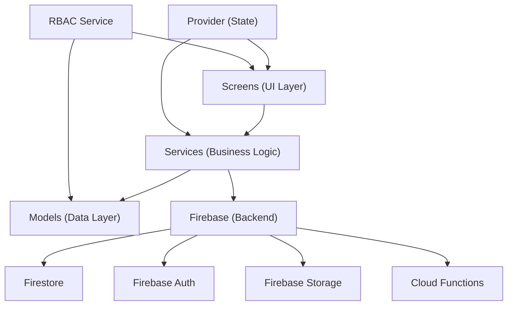
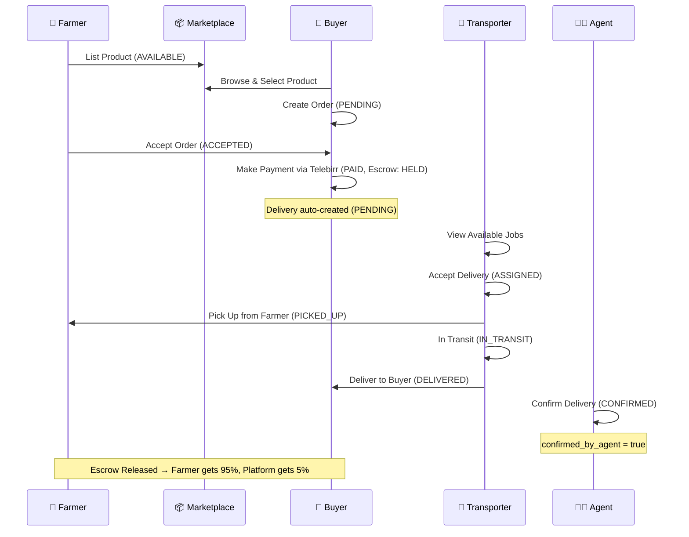
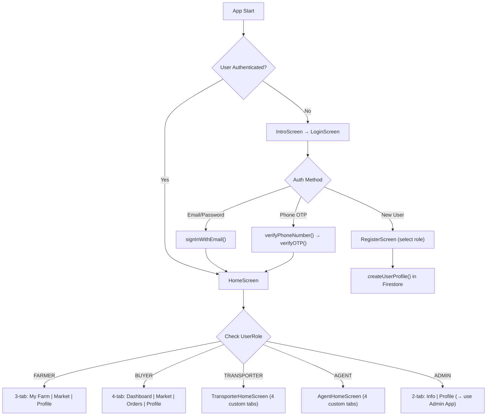

# AgriLink — Application Architecture & User Roles

AgriLink is a **multi-role agricultural marketplace** mobile application built with **Flutter** and **Firebase**. It connects farmers, buyers, transporters, and field agents in an end-to-end supply chain — from crop listing to delivery confirmation.

---

## 1. Tech Stack

| Layer | Technology |
|---|---|
| **Framework** | Flutter (Dart SDK ^3.6.1) |
| **State Management** | [Provider](file:///c:/Ag/pubspec.yaml#L48) (ChangeNotifier + Consumer pattern) |
| **Authentication** | [Firebase Auth](file:///c:/Ag/lib/services/auth_service.dart) — Email/Password + Phone OTP |
| **Database** | [Cloud Firestore](file:///c:/Ag/lib/services/firestore_service.dart) (NoSQL, real-time streams) |
| **Cloud Functions** | Firebase Cloud Functions (server-side logic) |
| **File Storage** | Firebase Storage (product images) |
| **Localization** | Flutter l10n — English (`en`) + Amharic (`am`) |
| **Image Handling** | `cached_network_image`, `image_picker` |

---

## 2. Project Structure

```
lib/
├── main.dart                    # App entry point, Firebase init, Provider setup, AuthWrapper
├── main_seed.dart               # Database seeding script
├── firebase_options.dart        # Firebase project configuration
├── l10n/                        # Localization (English + Amharic)
│
├── models/                      # Data layer — Firestore document models
│   ├── user_model.dart          # UserModel (uid, fullName, phone, role, faydaId, rating, etc.)
│   ├── user_role.dart           # UserRole enum: FARMER, BUYER, TRANSPORTER, AGENT, ADMIN
│   ├── product_model.dart       # ProductModel (cropName, quantityKg, pricePerKg, status, etc.)
│   ├── order_model.dart         # OrderModel (buyerId, farmerId, totalAmount, commission, status)
│   ├── delivery_model.dart      # DeliveryModel (orderId, transporterId, agentId, pickup/dropoff)
│   ├── payment_model.dart       # PaymentModel (payerId, payeeId, escrowStatus, amount)
│   └── support_ticket_model.dart # SupportTicketModel (userId, subject, agentReply, status)
│
├── services/                    # Business logic & data access layer
│   ├── auth_service.dart        # Firebase Auth wrapper (login, register, OTP, profile CRUD)
│   ├── firestore_service.dart   # Firestore CRUD & real-time streams for all collections
│   ├── rbac_service.dart        # Role-Based Access Control (permission checks per role)
│   └── language_service.dart    # Locale management (ChangeNotifier)
│
├── screens/                     # Presentation layer — organized by feature
│   ├── intro/                   # Onboarding / landing screen
│   ├── auth/                    # Login + Registration screens
│   ├── home/                    # Role-based navigation hub (HomeScreen)
│   ├── dashboard/               # Unified dashboard (stats, charts)
│   ├── marketplace/             # Product listing, details, creation
│   ├── orders/                  # Order creation, detail, tracking, payment
│   ├── logistics/               # Transporter home, Agent home, delivery dashboard
│   ├── profile/                 # User profile management
│   ├── support/                 # Support ticket screens
│   └── admin/                   # Admin dashboard (moved to separate app)
│
├── widgets/                     # Shared reusable UI components
│   ├── app_branded_header.dart  # Branded header with logo
│   ├── background_pattern.dart  # Decorative background
│   ├── product_card.dart        # Product listing card
│   └── status_badge.dart        # Status indicator badges
│
└── theme/
    └── app_theme.dart           # Material theme (light theme, color scheme)
```

---

## 3. Layered Architecture

The app follows a **Service-oriented layered architecture** (not strict Clean Architecture, but well-separated):



| Layer | Responsibility |
|---|---|
| **Models** | Pure Dart data classes with `fromFirestore()` / `toFirestore()` serialization and `copyWith()` immutability |
| **Services** | All Firebase interactions — auth flows, Firestore CRUD, real-time `Stream<List<T>>` queries, RBAC checks |
| **Screens** | Stateful/Stateless widgets consuming services via `Provider.of<T>()`. Role-based routing in [HomeScreen](file:///c:/Ag/lib/screens/home/home_screen.dart) |
| **Widgets** | Reusable UI components (cards, badges, headers) |
| **Provider** | Dependency injection of `AuthService`, `FirestoreService`, `LanguageService` at the root via `MultiProvider` |

---

## 4. Firestore Collections

| Collection | Document Fields (Key) | Purpose |
|---|---|---|
| `users` | `full_name`, `phone`, `email`, `role`, `fayda_id`, `is_verified`, `rating`, `address`, `city` | User profiles with role assignment |
| `products` | `farmer_id`, `crop_name`, `quantity_kg`, `price_per_kg`, `status` (AVAILABLE/RESERVED/SOLD/UNAVAILABLE), `image_url` | Crop listings by farmers |
| `orders` | `product_id`, `buyer_id`, `farmer_id`, `quantity_kg`, `total_amount`, `commission` (5%), `net_to_farmer` (95%), `status` | Purchase transactions |
| `deliveries` | `order_id`, `buyer_id`, `farmer_id`, `transporter_id`, `pickup_location`, `dropoff_location`, `delivery_status`, `confirmed_by_agent`, `agent_id` | Logistics tracking |
| `payments` | `order_id`, `payer_id`, `payee_id`, `payment_method` (default: TELEBIRR), `amount`, `escrow_status` | Escrow-based payment tracking |
| `support_tickets` | `user_id`, `user_name`, `user_role`, `subject`, `message`, `status`, `agent_id`, `agent_reply` | User support system |

---

## 5. User Roles & Permissions

The app defines **5 roles** in [user_role.dart](file:///c:/Ag/lib/models/user_role.dart). Permissions are enforced client-side by [rbac_service.dart](file:///c:/Ag/lib/services/rbac_service.dart) and server-side by [firestore.rules](file:///c:/Ag/firestore.rules).

---

### 🌾 FARMER

> **Purpose**: Produce and list agricultural products for sale.

| Capability | Details |
|---|---|
| **Create products** | List crops with name, quantity (kg), price/kg, harvest date, location, image |
| **Edit/Delete own products** | Only their own listings (RBAC: `user.uid == productOwnerId`) |
| **View Dashboard** | "My Farm" tab — stats on their products and incoming orders |
| **Receive orders** | View orders placed by buyers on their products |
| **Accept/Reject orders** | Update order status (PENDING → ACCEPTED or CANCELLED) |
| **Track deliveries** | View delivery status for their products |
| **View marketplace** | Browse all available products |

**Navigation**: `My Farm` → `Market` → `Profile` (3 tabs)

---

### 🛒 BUYER

> **Purpose**: Browse products, place orders, and make payments.

| Capability | Details |
|---|---|
| **Browse marketplace** | View all AVAILABLE products with search/filter |
| **View product details** | See crop info, farmer details, pricing |
| **Create orders** | Place orders specifying quantity, delivery address |
| **Make payments** | Pay via TELEBIRR (escrow: PENDING → HELD → RELEASED) |
| **Track deliveries** | Real-time delivery tracking (status updates) |
| **Create deliveries** | Auto-created when order is paid (Firestore rules allow buyers to create delivery docs) |
| **View order history** | "My Orders" tab with status filtering |
| **Submit support tickets** | Request help via the support system |

**Navigation**: `Dashboard` → `Market` → `Orders` → `Profile` (4 tabs)

---

### 🚛 TRANSPORTER

> **Purpose**: Pick up and deliver agricultural products from farmers to buyers.

| Capability | Details |
|---|---|
| **View available jobs** | Browse PENDING deliveries with no transporter assigned |
| **Accept deliveries** | Self-assign to a delivery (status: PENDING → ASSIGNED) |
| **Update delivery status** | Progress through: ASSIGNED → PICKED_UP → IN_TRANSIT → DELIVERED |
| **View active deliveries** | Monitor their current active shipments |
| **View delivery history** | All past completed deliveries |
| **View earnings** | Track completed delivery count and performance |

**Navigation**: Dedicated [TransporterHomeScreen](file:///c:/Ag/lib/screens/logistics/transporter_home_screen.dart) with 4 custom tabs

---

### 🧑‍💼 AGENT (Field Agent)

> **Purpose**: Oversee operations, confirm deliveries, manage support tickets, and view analytics.

| Capability | Details |
|---|---|
| **Dashboard overview** | View platform-wide stats (orders, deliveries, users) |
| **Manage tasks** | View and manage all deliveries and orders in the system |
| **Confirm deliveries** | Physically verify delivery and mark `confirmed_by_agent = true` (status → CONFIRMED) |
| **Update any delivery** | Can modify delivery status regardless of assignment |
| **Handle support tickets** | View all open tickets, reply, and resolve them |
| **View analytics/reports** | Access platform reports and performance data |
| **View all deliveries** | Full oversight of all deliveries system-wide |

**Navigation**: Dedicated [AgentHomeScreen](file:///c:/Ag/lib/screens/logistics/agent_home_screen.dart) with tabs:
- [Dashboard](file:///c:/Ag/lib/screens/logistics/agent_dashboard_tab.dart)
- [Tasks](file:///c:/Ag/lib/screens/logistics/agent_tasks_tab.dart)
- [Support](file:///c:/Ag/lib/screens/logistics/agent_support_screen.dart)
- [Reports](file:///c:/Ag/lib/screens/logistics/agent_reports_tab.dart)

---

### 🛡️ ADMIN (Administrator)

> **Purpose**: Full system access — manage users, platform settings, and override any operation.

| Capability | Details |
|---|---|
| **Manage all users** | View, update, delete any user profile |
| **Create/Edit/Delete any product** | Full product management regardless of ownership |
| **Create/Update any order** | Override order status |
| **Update deliveries** | Modify any delivery record |
| **Manage payments** | Only admins can update payment/escrow status |
| **Delete any record** | Delete orders, deliveries, payments, products |
| **View analytics** | Full platform analytics access |

> [!IMPORTANT]
> The Admin role is **redirected to a separate admin application**. In this mobile app, admin users see an informational screen ([_AdminRemovedScreen](file:///c:/Ag/lib/screens/home/home_screen.dart#L167-L267)) directing them to use the dedicated AgriLink Admin app.

**Navigation**: `Info` → `Profile` (2 tabs — limited in this app)

---

## 6. RBAC Permission Matrix

From [rbac_service.dart](file:///c:/Ag/lib/services/rbac_service.dart):

| Permission | FARMER | BUYER | TRANSPORTER | AGENT | ADMIN |
|---|:---:|:---:|:---:|:---:|:---:|
| Create Product | ✅ | ❌ | ❌ | ❌ | ✅ |
| Edit Own Product | ✅ | ❌ | ❌ | ❌ | ✅ |
| Delete Own Product | ✅ | ❌ | ❌ | ❌ | ✅ |
| Create Order | ❌ | ✅ | ❌ | ❌ | ✅ |
| View Order (participant) | ✅* | ✅* | ❌ | ❌ | ✅ |
| Update Delivery | ❌ | ❌ | ✅* | ✅ | ✅ |
| Confirm Delivery | ❌ | ❌ | ❌ | ✅ | ✅ |
| Manage Users | ❌ | ❌ | ❌ | ❌ | ✅ |
| View Analytics | ❌ | ❌ | ❌ | ✅ | ✅ |

\* = Only for records they are a participant in (own orders, assigned deliveries)

---

## 7. Order & Delivery Lifecycle



### Order Statuses
`PENDING` → `ACCEPTED` → `PAID` → `IN_TRANSIT` → `DELIVERED` → `COMPLETED` → (or `CANCELLED`)

### Delivery Statuses
`PENDING` → `ASSIGNED` → `PICKED_UP` → `IN_TRANSIT` → `DELIVERED` → `CONFIRMED`

### Escrow/Payment Statuses
`PENDING` → `HELD` → `RELEASED` (or `REFUNDED`)

---

## 8. Authentication Flow



---

## 9. Key Design Decisions

| Decision | Rationale |
|---|---|
| **5% commission model** | Built into [OrderModel](file:///c:/Ag/lib/models/order_model.dart#L89-L90) — `commission = totalAmount * 0.05`, `netToFarmer = totalAmount * 0.95` |
| **Escrow payments** | Buyer funds are HELD until agent confirms delivery, then RELEASED to farmer |
| **Fayda ID field** | Ethiopian national digital ID integration for user verification |
| **Agent delivery confirmation** | Physical verification step prevents fraud — `confirmed_by_agent` boolean on [DeliveryModel](file:///c:/Ag/lib/models/delivery_model.dart#L59) |
| **Amharic localization** | Bilingual support (English + Amharic) for Ethiopian market |
| **Admin app separation** | Admin features moved to a dedicated app for better security |
| **Telebirr default payment** | Ethiopian mobile money as the default payment method |
