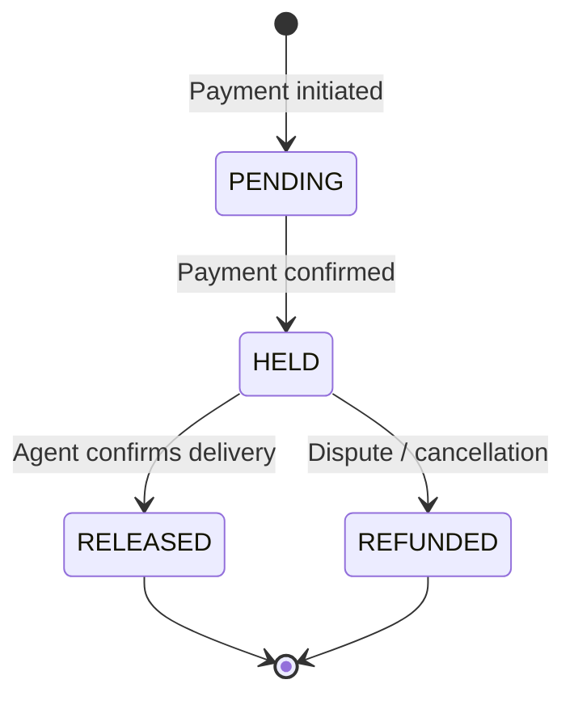
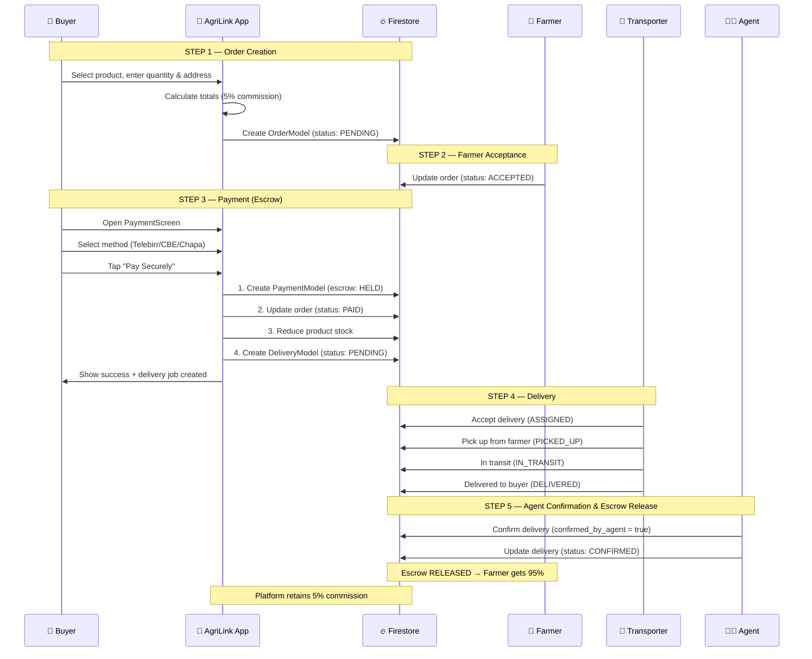

# AgriLink — Payment Structure (Deep Dive)

## Overview

AgriLink uses an **Escrow-based payment system** where buyer funds are **held** by the platform until a field **Agent** physically confirms delivery. This protects both parties — the buyer is guaranteed delivery, and the farmer is guaranteed payment.

The currency is **ETB (Ethiopian Birr)** and the default payment method is **Telebirr** (Ethiopian mobile money).

---

## 1. Commission & Fee Model

The platform takes a **fixed 5% commission** on every transaction. This is calculated at **order creation time** and stored directly on the order document.

### Calculation (from [create_order_screen.dart](file:///c:/Ag/lib/screens/orders/create_order_screen.dart#L63-L78))

```
totalAmount   = quantity (kg) × pricePerKg
commission    = totalAmount × 0.05       (5% platform fee)
netToFarmer   = totalAmount − commission  (95% to farmer)
```

### Example

| Field | Value |
|---|---|
| Product | Teff |
| Price per kg | ETB 80 |
| Quantity ordered | 100 kg |
| **Total Amount** | **ETB 8,000** |
| Platform Fee (5%) | ETB 400 |
| **Net to Farmer** | **ETB 7,600** |

> [!IMPORTANT]
> The **buyer pays the full `totalAmount`** (ETB 8,000). The commission is deducted internally — the farmer receives `netToFarmer` (ETB 7,600) when escrow is released. The buyer does NOT pay extra fees on top.

### Where this is stored (from [order_model.dart](file:///c:/Ag/lib/models/order_model.dart#L89-L90))

```dart
commission: commission ?? (totalAmount * 0.05),  // 5% default
netToFarmer: netToFarmer ?? (totalAmount * 0.95),
```

### What the farmer sees

On the [Order Detail Screen](file:///c:/Ag/lib/screens/orders/order_detail_screen.dart#L209-L223), farmers see a breakdown that is **only visible to them**:

```
Total Amount:    ETB 8,000
Platform Fee:   -ETB 400    (shown in red)
Net Earnings:    ETB 7,600  (shown in green, bold)
```

Buyers only see the `Total Amount` — they don't see the commission split.

---

## 2. Supported Payment Methods

From [payment_screen.dart](file:///c:/Ag/lib/screens/orders/payment_screen.dart#L261-L280), three payment methods are offered:

| Method | Icon | Description |
|---|---|---|
| **Telebirr** | 📱 `phone_android` | Ethiopia's largest mobile money platform (Ethio Telecom) |
| **CBE Birr** | 💳 `account_balance_wallet` | Commercial Bank of Ethiopia mobile wallet |
| **Chapa (Card/Bank)** | 💳 `credit_card` | Chapa payment gateway — supports cards and bank transfers |

> [!NOTE]
> Currently, the payment processing is **simulated** — the app creates the payment record and marks it as `HELD` immediately without actual gateway integration. The `paymentMethod` string is stored on the `PaymentModel` but no real API call is made to Telebirr, CBE Birr, or Chapa.

---

## 3. Payment Data Model

From [payment_model.dart](file:///c:/Ag/lib/models/payment_model.dart):

```dart
class PaymentModel {
  final String id;              // Auto-generated by Firestore
  final String orderId;         // Links to the order
  final String payerId;         // Buyer's UID
  final String payeeId;         // Farmer's UID
  final String paymentMethod;   // 'Telebirr', 'CBE Birr', or 'Chapa'
  final double amount;          // Full totalAmount (buyer pays this)
  final EscrowStatus escrowStatus;  // PENDING → HELD → RELEASED/REFUNDED
  final DateTime createdAt;
  final DateTime? releasedAt;   // When escrow was released to farmer
}
```

### Escrow Statuses



| Status | Meaning | Trigger |
|---|---|---|
| `PENDING` | Payment has been initiated but not yet confirmed | Default when `PaymentModel` is first conceptualized (not currently used — payments are created directly as `HELD`) |
| `HELD` | Funds received and held in escrow by the platform | Created when buyer clicks "Pay Securely" on the [PaymentScreen](file:///c:/Ag/lib/screens/orders/payment_screen.dart#L36) |
| `RELEASED` | Funds released to the farmer (minus commission) | Triggered after Agent confirms delivery |
| `REFUNDED` | Funds returned to the buyer | Dispute resolution or order cancellation |

---

## 4. End-to-End Payment Flow



---

## 5. What Happens on "Pay Securely" (Step-by-Step)

When the buyer taps the pay button, the [_processPayment()](file:///c:/Ag/lib/screens/orders/payment_screen.dart#L22-L178) method executes **5 sequential operations**:

| Step | Action | Firestore Operation |
|---|---|---|
| **1** | Create payment record | `payments` collection → new doc with `escrow_status: HELD` |
| **2** | Update order status | `orders/{id}` → `status: PAID` |
| **3** | Reduce product stock | `products/{id}` → `quantity_kg -= orderedQty`. If remaining ≤ 0, set `status: SOLD` |
| **4** | Resolve delivery locations | Read product location (pickup) + order address/city (dropoff) |
| **5** | Create delivery job | `deliveries` collection → new doc with `status: PENDING`, visible to transporters |

> [!WARNING]
> Steps 3-5 have individual `try/catch` blocks — if stock reduction or delivery creation fails, the payment and order update still succeed. This prevents a complete transaction rollback but may leave inconsistent state.

---

## 6. Firestore Security Rules for Payments

From [firestore.rules](file:///c:/Ag/firestore.rules#L92-L105):

```
match /payments/{paymentId} {
  // READ: Only payer (buyer), payee (farmer), or admin
  allow read: if authenticated &&
    (resource.data.payer_id == request.auth.uid ||
     resource.data.payee_id == request.auth.uid ||
     isAdmin());

  // CREATE: Only the payer (buyer) or admin
  allow create: if authenticated &&
    (request.resource.data.payer_id == request.auth.uid || isAdmin());

  // UPDATE: Only admins can update payment status
  allow update: if isAdmin();

  // DELETE: Only admins
  allow delete: if isAdmin();
}
```

| Operation | Who Can Do It |
|---|---|
| **Read** a payment | The buyer (payer), the farmer (payee), or Admin |
| **Create** a payment | The buyer (must be the payer), or Admin |
| **Update** a payment (e.g., release escrow) | **Admin only** |
| **Delete** a payment | **Admin only** |

> [!IMPORTANT]
> Agents **cannot** directly update payment records in Firestore — only Admins can. The escrow release after agent confirmation would need to happen via a **Cloud Function** or admin-side operation, which is currently **not implemented in the client app**.

---

## 7. Money Flow Diagram

```
┌────────────────────────────────────────────────────────────────┐
│                      BUYER PAYS ETB 8,000                      │
│                   (via Telebirr/CBE/Chapa)                     │
└────────────────────────────┬───────────────────────────────────┘
                             │
                             ▼
                  ┌─────────────────────┐
                  │   ESCROW (HELD)     │
                  │   ETB 8,000         │
                  │                     │
                  │  Held until Agent   │
                  │  confirms delivery  │
                  └─────────┬───────────┘
                            │
               Agent confirms delivery
                            │
              ┌─────────────┴─────────────┐
              │                           │
              ▼                           ▼
   ┌──────────────────┐        ┌──────────────────┐
   │  FARMER RECEIVES │        │  PLATFORM KEEPS  │
   │                  │        │                  │
   │  ETB 7,600       │        │  ETB 400         │
   │  (95%)           │        │  (5% commission) │
   └──────────────────┘        └──────────────────┘
```

---

## 8. Current Gaps & Limitations

| Gap | Details |
|---|---|
| **No real payment gateway integration** | Payment is simulated — no actual Telebirr/CBE/Chapa API calls. The record is created directly as `HELD` without verifying real money movement. |
| **No automatic escrow release** | When an Agent confirms delivery (`confirmed_by_agent = true`), there is no Cloud Function or trigger that automatically updates the `PaymentModel` from `HELD` → `RELEASED`. This would need to be done manually by an Admin or via a backend function. |
| **No refund flow in the UI** | The `REFUNDED` status exists in the model, but there is no screen or button for initiating refunds. Only Admins can update payment status via Firestore rules. |
| **No transaction history screen** | There is no dedicated "Payments" or "Wallet" screen showing payment history. Payment info is only visible within the order detail context. |
| **No support ticket linked to payment disputes** | Support tickets exist but aren't directly linked to specific payment/order disputes. |
| **Stock reduction is non-atomic** | The product stock is reduced client-side with a read-then-write pattern, which could cause race conditions under concurrent orders for the same product. |
| **Commission rate is hardcoded** | The 5% fee is hardcoded in both [OrderModel](file:///c:/Ag/lib/models/order_model.dart#L89) and [CreateOrderScreen](file:///c:/Ag/lib/screens/orders/create_order_screen.dart#L68). There's no admin-configurable commission rate. |

---

## 9. Summary Table

| Aspect | Current Implementation |
|---|---|
| **Currency** | ETB (Ethiopian Birr) |
| **Commission** | 5% fixed (hardcoded) |
| **Payment Methods** | Telebirr, CBE Birr, Chapa (simulated) |
| **Escrow Model** | PENDING → HELD → RELEASED / REFUNDED |
| **Who pays** | Buyer pays full amount |
| **Who receives** | Farmer gets 95% after delivery confirmation |
| **Escrow release trigger** | Agent confirms delivery (manual/backend) |
| **Payment security rules** | Only buyer can create, only admin can modify |
| **Delivery auto-creation** | Yes — created automatically when buyer pays |
| **Stock reduction** | Automatic — done at payment time |
